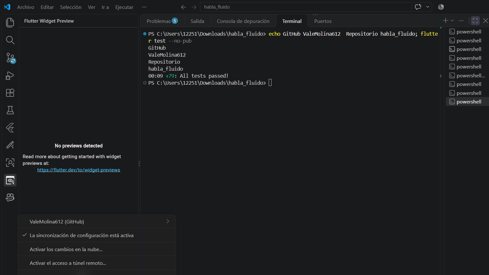
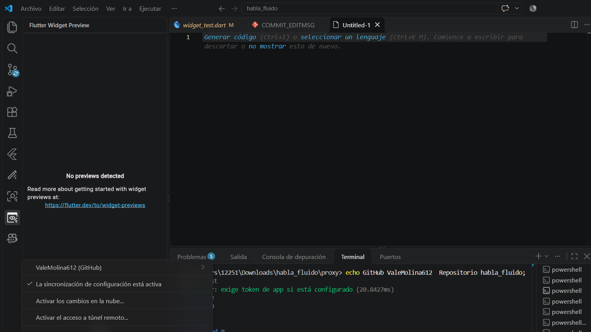

# Habla Fluido

### pubspec.yaml


### reglas
 


### nivel 


### exception 


### Fase roja 


### Fase verde real de Flutter








## Ejecutar las pruebas

Desde la carpeta principal:

```powershell
flutter pub get
flutter test
```

Para el proxy:

```powershell
cd proxy
node --test
```

## Ejecutar la aplicación sin IA externa

```powershell
flutter run
```

## Ejecutar con el proxy local

En una primera terminal:

```powershell
cd C:\Users\12251\Downloads\habla_fluido\proxy
$env:ANTHROPIC_API_KEY="tu_llave"
node server.js
```

En otra terminal, desde la carpeta principal:

```powershell
flutter run --dart-define=TUTOR_URL=http://10.0.2.2:8787/tutor --dart-define=TUTOR_LOCAL=true
```

`10.0.2.2` permite que el emulador Android se conecte con el servidor que se ejecuta en la computadora. La llave de la API permanece únicamente en el proxy y nunca debe guardarse en Flutter ni en Git.

