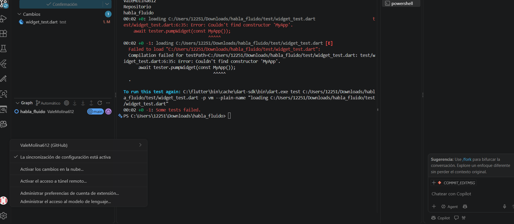

# Habla Fluido


### Fase roja real

.



### Fase verde real de Flutter


## Pruebas incluidas

| Archivo | Cobertura principal |
|---|---|
| `test/comparador_test.dart` | Normalización, Levenshtein, similitud, palabras correctas, parecidas, sustituidas, omitidas y sobrantes. |
| `test/repaso_progreso_test.dart` | SM-2, fechas, calidad, tarjetas, promedio móvil, racha, nivel y plan diario. |
| `test/tutor_test.dart` | JSON no confiable, tutor simulado, HTTPS, historial, UTF-8 y errores seguros. |
| `test/vms_test.dart` | Pronunciación, dictado, lectura, escritura, conversación, persistencia y repaso. |
| `test/widget_test.dart` | Inicio real de la aplicación y contenido principal de la pantalla. |
| `proxy/test/proxy.test.js` | Prompt, inyección, validación, proveedor de IA, códigos HTTP, rate limit y token. |


## Ejecutar las pruebas

Desde la carpeta principal:

```powershell
flutter pub get
flutter test
```

Para el proxy:

```powershell
cd proxy
node --test
```

## Ejecutar la aplicación sin IA externa

```powershell
flutter run
```

Sin configuración adicional, la aplicación utiliza el tutor simulado y no genera costos.

## Ejecutar con el proxy local

En una primera terminal:

```powershell
cd C:\Users\12251\Downloads\habla_fluido\proxy
$env:ANTHROPIC_API_KEY="tu_llave"
node server.js
```

En otra terminal, desde la carpeta principal:

```powershell
flutter run --dart-define=TUTOR_URL=http://10.0.2.2:8787/tutor --dart-define=TUTOR_LOCAL=true
```

`10.0.2.2` permite que el emulador Android se conecte con el servidor que se ejecuta en la computadora. La llave de la API permanece únicamente en el proxy y nunca debe guardarse en Flutter ni en Git.

## Permisos móviles

Android utiliza permisos de Internet y micrófono. iOS necesita descripciones para el uso del micrófono y el reconocimiento de voz. El audio puede ser procesado por el servicio de voz del sistema, por lo que la aplicación debe informar esta condición al estudiante.


